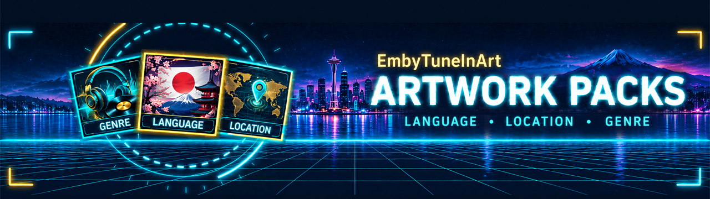
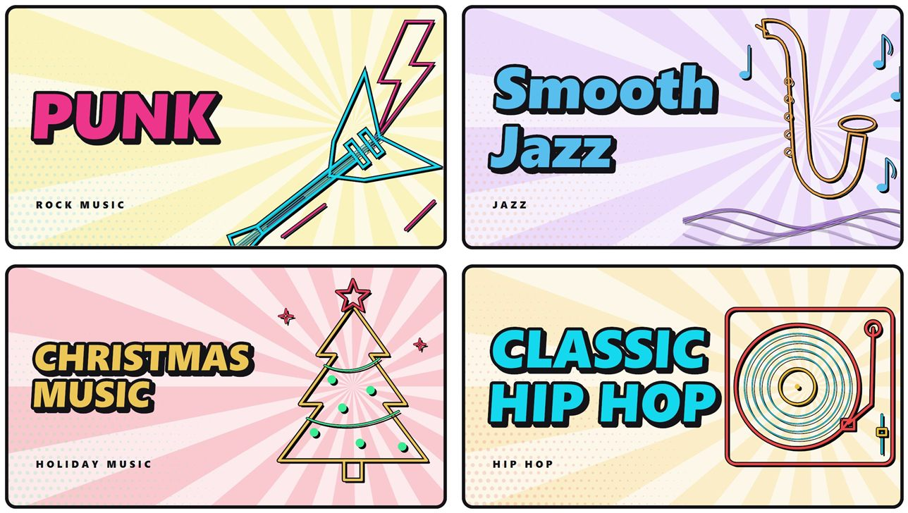
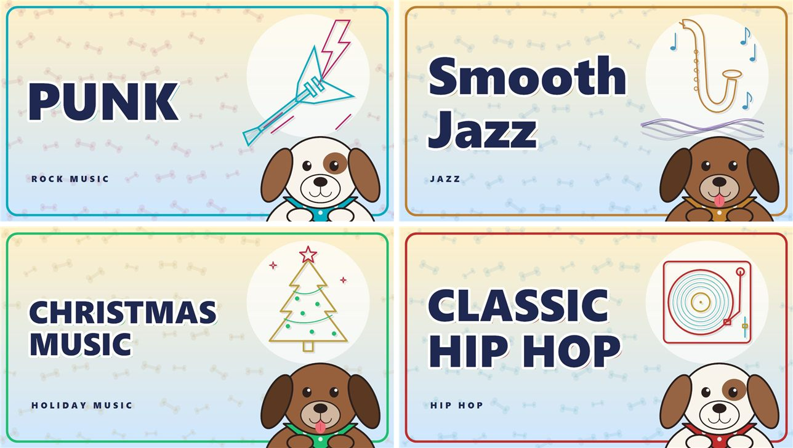

# EmbyTuneInArt — artwork packs for the EmbyTuneIn plugin



EmbyTuneInArt builds optional artwork packs for the music genre, language and location folders of the
[Emby TuneIn plugin](https://github.com/oconnoradv/EmbyTuneIn). `Build-GenreArtwork.ps1` produces original
1280×720 JPEG cards for one scope at a time in any of thirteen [themes](#themes). Music genres and subgenres
inherit typography, palette and line art from their parent genre; language and location cards use the same themes.
The cards contain no TuneIn logos or station images.

The plugin ships with default category icons. Packs are optional and replace icons for matching guide IDs in
Music, Languages or Locations. Existing ready-made genre packs are on the
[Releases](https://github.com/oconnoradv/EmbyTuneInArt/releases) page; build scoped packs with this tool.

## Themes

Pick a theme with `-Theme <name>` (default `Futuristic`). Each sample shows Punk, Smooth Jazz, Christmas Music and
Classic Hip Hop.

| Theme | Look | Sample |
|---|---|---|
| `Futuristic` | Holographic HUD rings, a perspective grid floor, scanlines and chromatic glow. |  |
| `Classic` | Bold centred typography in each genre's font on a rich genre gradient, with faint line art and an accent band. |  |
| `Tile` | The original plugin look: a dark-to-violet gradient, line art in a rounded tile and a centred caption. |  |
| `Neon` | Glowing neon line art on dark gradients (the original pack). |  |
| `Retro` | Cream paper, sunburst, stripes and offset print shadows in a muted 1970s palette. |  |
| `Cartoon` | Comic-panel border, burst rays and halftone dots with bold outlined line art. |  |
| `Cat` | Pastel paw-print wallpaper with a headphone-wearing cartoon cat; fur colour varies by genre. |  |
| `Dog` | Sunny bone-print wallpaper with a bandana-wearing cartoon dog; fur varies by genre. |  |
| `Nature` | Layered mountain ridges, pines, a soft sun and earthy line art. |  |
| `Blocky` | Chunky pixel art inspired by voxel sandbox games: blocky sky, clouds and grass-and-dirt ground. |  |
| `Rebel` | Scrappy sci-fi resistance: starfield, a dusky planet, weathered orange titles and hazard stripes. |  |
| `Imperial` | Cold, symmetrical sci-fi empire: steel panels, corridor lights and red accent bars. |  |
| `Elegant` | Quiet charcoal, a warm vignette, champagne hairline art and serif titles. |  |

Themes are original designs. `Blocky`, `Rebel` and `Imperial` evoke familiar genres of game and film art without
using any franchise's names, logos, emblems or fonts.

## Install a ready-made pack

1. Download a pack ZIP, for example `artpack-neon-v1.zip`, from
   [Releases](https://github.com/oconnoradv/EmbyTuneInArt/releases).
2. In Emby, open **Settings → TuneIn → Advanced Settings → Custom Artwork Packs**, then expand
   **Details & installation** for the folder paths. For example, the genres folder may be
   `C:\ProgramData\Emby-Server\programdata\plugins\configurations\TuneInArtwork\genres`.
3. Create the appropriate `genres`, `languages` or `locations` folder if it does not exist and extract that scope's
   `.jpg` files and `tunein-artwork.json` into it. Keep one pack per scope. Do not mix manifests between folders.
4. Reload the TuneIn settings page. The artwork table shows the installed pack and image counts separately for
   **Music genres**, **Languages** and **Locations**. Details include modified and added counts.
5. Under **Catalog Refresh → TuneIn Library Refresh**, refresh **Music** for genres, **By Language** for
   languages or **By Location** for locations. Also refresh **By Language** after changing genre cards if you
   browse genres under languages. Alternatively use **Refresh all enabled categories**.

To go back to the default icons, remove that scope's images and refresh the corresponding catalog again.
Remove `tunein-artwork.json` too if the status should show Default artwork instead of the old pack name.
Only files named
after a TuneIn guide ID are used: `c` or `g` for genres, `l` for languages and `r` for locations, followed by
1–10 digits with a nonzero first digit. Entries without an image keep their default icons.

## Build your own pack, step by step

Requirements:

- Windows 11 with Windows PowerShell 5.1 (`System.Drawing`).
- The Windows fonts Bahnschrift, Segoe UI Variable, Segoe UI Black, Cascadia Mono, Impact, Georgia and
  Franklin Gothic Medium. A missing required title font stops the build.
- Internet access to `opml.radiotime.com`, which supplies the current catalog.
- For native scripts, Windows fonts including Meiryo, Microsoft YaHei, Malgun Gothic, Nirmala UI,
  Leelawadee UI, Myanmar Text and MV Boli. The build fails if a selected font is unavailable.
  Noto Sans Khmer is bundled for Khmer.

1. **Clone the repository.**

   ```powershell
   git clone https://github.com/oconnoradv/EmbyTuneInArt.git
   cd EmbyTuneInArt
   ```

2. **Preview a few genres.** `-Only` takes guide IDs or `-like` name patterns. For languages it accepts the
   TuneIn label or the native title. Open the folder to check the cards.

   ```powershell
   powershell -NoProfile -ExecutionPolicy Bypass -Command "& .\Build-GenreArtwork.ps1 -Theme Retro -Output .\preview -Only 'Punk','Christmas*','Smooth Jazz'"
   ```

   Use `-Command` as shown: `-File` passes a comma-separated `-Only` list as one string.

3. **Adjust the look (optional).** Try other `-Theme` values or edit the tables described under
   [Customizing](#customizing), then repeat step 2 until you are happy.

4. **Build the full genre pack.** This writes the discovered cards and `tunein-artwork.json` to `.\output\genres`
   and the ZIP to `.\output\artpack-retro.zip`. `-PackName` overrides the name; its default is
   `artpack-<theme>` for genres and `artpack-<theme>-<scope>` for other scopes. `-PackVersion` sets the
   manifest version and defaults to `1`. The number of cards depends on TuneIn's current catalog.

   ```powershell
   powershell -NoProfile -ExecutionPolicy Bypass -File Build-GenreArtwork.ps1 -Theme Retro -Pack
   ```

5. **Install it** by following [Install a ready-made pack](#install-a-ready-made-pack) from step 2, using your ZIP.
   To install straight from a build on the Emby server, point `-Output` at the artwork folder:

   ```powershell
   powershell -NoProfile -ExecutionPolicy Bypass -File Build-GenreArtwork.ps1 -Output 'C:\ProgramData\Emby-Server\programdata\plugins\configurations\TuneInArtwork\genres'
   ```

   Build other scopes with the same themes:

   ```powershell
   powershell -NoProfile -ExecutionPolicy Bypass -File Build-GenreArtwork.ps1 -Scope languages -Theme Cartoon -Pack
   powershell -NoProfile -ExecutionPolicy Bypass -File Build-GenreArtwork.ps1 -Scope locations -Theme Classic -Pack
   ```

   Outputs default to `output\languages` and `output\locations`, with scope-specific ZIP names. Scoped packs
   require a TuneIn build with scoped artwork support; `minPluginVersion` alone cannot distinguish older 1.2.8 RCs.
   To preview a bounded Canadian subtree through its cities:

   ```powershell
   powershell -NoProfile -ExecutionPolicy Bypass -Command "& .\Build-GenreArtwork.ps1 -Scope locations -LocationRoot r101227 -LocationRootLevel 2 -LocationDepth 4 -Only 'Canada','Alberta','Calgary' -Output .\preview-locations"
   ```

   The default root is `r0` (level 0). Levels 1–4 correspond to continent, country, region and city where
   TuneIn uses that hierarchy. Provider hierarchies vary; an explicitly supplied root must have its correct level.
   The default depth is 4 and discovery stops before browsing city nodes. At most 1,000 browse requests are made;
   exceeding `-MaxLocationRequests` fails the build rather than silently publishing an incomplete pack. A full
   locations build may hit that limit; increase it explicitly (maximum 10,000) or restrict the root/depth.
   Only location links are followed; station and other pivot items are ignored.

   Language titles use a curated mapping to Windows neutral-culture native names. Unknown or ambiguous categories
   retain the TuneIn label with a warning. Japanese and Icelandic use labeled representative flags by default;
   `-NeutralLanguages` replaces those with a neutral globe. Other languages use a neutral globe rather than assigning
   a country to a language.

   Country outlines and curated US/Canadian region outlines use the bundled public-domain Natural Earth
   110m countries and 50m admin-1 data, matched by name and country. Region IDs are explicitly verified because
   the provider does not label regions versus cities. Map coverage is limited; cities, unmatched
   regions, ambiguous/unsupported geometry and antimeridian-spanning shapes use a globe explicitly labeled
   **Generic location**. A map is a stylized outline, not a navigation map.

6. **Share it (optional).** Publish the ZIP as a release, for example with
   `gh release create artpack-<name>-v1 .\output\<name>.zip`.

Each card prints `id  name  [style/motif]` as it is drawn.
Run the offline discovery and geometry checks with
`powershell -NoProfile -ExecutionPolicy Bypass -File .\tests\Scoped-Artwork.Tests.ps1`.

## Pack manifest

Every build writes `tunein-artwork.json` next to the cards, and `-Pack` includes it in the ZIP. It is installed
in the scope folder with the images so the TuneIn plugin can identify the pack:

| Field | Meaning |
|---|---|
| `schemaVersion` | Manifest format version, currently `1`. |
| `scope` | `genres`, `languages` or `locations`; legacy manifests without this field are genres only. |
| `packId`, `packName`, `theme`, `version` | Pack identity, for example `artpack-cartoon`, `Cartoon`, `Cartoon`, `1`. |
| `description` | The theme's one-line description. |
| `minPluginVersion` | Plugin assembly version (`1.2.8.0`); scoped support requires the newer scoped-artwork RC build. |
| `sampleImageUrl`, `sourceUrl` | An optional genre sample image and the repository the pack was built from. |
| `toolCommit`, `builtUtc`, `license` | The tool commit, build time and licence (`GPL-3.0`). |
| `imageCount`, `images` | One entry per card: `id`, `name`, `parent`, `file`, `bytes` and lower-case `sha256`. |

The plugin compares installed files with the manifest: missing entries are absent, matching hashes identify
unchanged pack cards, differing hashes identify modified cards, and extra files are added images. The manifest
and ZIP list only cards rendered in the current build, so a `-Only` build describes just those cards. Use a clean
output folder when switching packs: older files are not deleted and the plugin can report them as added images.

## Roadmap

- **GUI front end.** A future version will add a graphical front end to simplify usage: pick entries, preview cards,
  tune styles and glow, and build or install a pack without editing the script or using the command line.

## How it works

1. **Discovery.** Genres come from `Browse.ashx?c=music` and each top-level genre's `Browse.ashx?id=<id>`.
   Languages come from `Browse.ashx?c=lang`, using each link's `filter=l…` rather than its hub ID.
   Locations use the bounded `Browse.ashx?id=r…` hierarchy. Each output file is named `<guide_id>.jpg`.
2. **Style.** `$Parents` maps every top-level genre to a style group and default motif. Subgenres inherit
   their parent's style.
3. **Typography and palette.** `$Styles` defines each style group's font, case, shear, title mode
   (`Fill` or `Tube` outline), maximum size and palette (`bgTop`, `bgBottom`, three neon colours).
   A subgenre uses the parent's colours, rotated by a per-genre seed, so siblings differ.
4. **Motif.** The `$Overrides` table maps subgenre name regexes to a motif and is checked in order; the
   first match wins. `$Places` gives a latitude and longitude, which mark World subgenres on the globe motif.
   For other scopes, `Scoped-Artwork.ps1` chooses representative flags, verified map outlines or neutral globes.
5. **Theme.** `$Themes` holds one entry per theme. An entry can recolour the palette (`Color`), set the line-art
   mode (`Art`: `Glow`, `Flat` with shadow and outline, or `Pixel`), and supply the `Background`, a `Clip`, a
   `Character`, the `Title` treatment, font overrides and the subtitle style.
6. **Rendering.** `New-Card` draws, in order:
   - the theme background;
   - the motif, through `Neon`, in the theme's line-art mode (scaled and moved by the theme's `OX`, `OY`, `Scale`);
   - the theme character, if any (the Cat and Dog themes);
   - the title, auto-fitted on 1–3 lines by `Title-Path` and drawn by the theme;
   - a parent-genre or scope-specific subtitle.

## Customizing

- **New motif:** add `function Motif-<name>($cl, $info)` that calls `Neon $cl[i] { param($g, $c, $k) ... }`.
  - Draw around (0,0), within about ±240 × ±290; `$script:OX`/`$script:OY` place the artwork.
  - Build pens with `Pn $c <width> $k` so every theme can scale the stroke.
  - Then reference the motif from `$Parents` or `$Overrides`.
- **New theme:** copy a `$Themes` entry, rename it and add the name to the `-Theme` `ValidateSet`.
- **Glow strength:** `$script:Weight` scales every stroke (default 0.7). A theme's `Art.Glow` sets the glow
  opacity (Neon uses 0.65). The `0.08, 0.04, 0.02` scales set the glow radius. Higher values look louder
  and blurrier.
- **Title look:** edit the matching `$Styles` entry. `Tube` titles are outlined; `Fill` titles are solid.
- **New TuneIn genres** are picked up automatically and use their parent's defaults. Add an override
  when a more specific motif fits.
- **Language and location artwork:** edit the curated culture, flag and verified-region mappings in
  `Scoped-Artwork.ps1`; unverified categories deliberately keep their provider name or generic motif.

After you replace installed images, refresh the corresponding catalog again. The plugin notices the changed files and replaces
Emby's cached folder images.

## License

EmbyTuneInArt and the artwork it produces are licensed under the [GNU General Public License v3.0](LICENSE).
The bundled `data\natural-earth.json` is derived from Natural Earth v5.1.2
[`ne_110m_admin_0_countries`](https://github.com/nvkelso/natural-earth-vector/blob/v5.1.2/geojson/ne_110m_admin_0_countries.geojson)
and [`ne_50m_admin_1_states_provinces`](https://github.com/nvkelso/natural-earth-vector/blob/v5.1.2/geojson/ne_50m_admin_1_states_provinces.geojson):
only names, country names and geometry were retained. Natural Earth data is
[public domain](https://www.naturalearthdata.com/about/terms-of-use/). The flag motifs are original geometric drawings.
`data\NotoSansKhmer-Regular.ttf` is from
[Noto Fonts](https://github.com/notofonts/noto-fonts/tree/ffebf8c1ee449e544955a7e813c54f9b73848eac/hinted/ttf/NotoSansKhmer)
and is distributed under the [SIL Open Font License 1.1](data/Noto-OFL.txt).
