# Emby TuneIn Art Packs & Generation Tool


Download ready-made packs or create original 1280×720 artwork for the [Emby TuneIn plugin](https://github.com/oconnoradv/EmbyTuneIn).
Choose a pack type:

**Migration:** The published downloads below are legacy schema 1 packs and cannot be uploaded to a schema 2-only
TuneIn build. No schema 2 release packs have been published yet; build a new pack using the instructions below.
Existing installed artwork is not deleted during the migration, but its old manifest is unsupported until replaced.

**[Music genre packs](https://github.com/oconnoradv/EmbyTuneInArt/releases) ·
[Language packs](#complete-language-and-location-packs) ·
[Location packs](#complete-language-and-location-packs) ·
[Root category packs](#root-category-packs)**

`Build-GenreArtwork.ps1` builds one scope at a time in any of sixteen [themes](#themes). Music genres and subgenres
inherit typography, palette and line art from their parent genre; language, location and root category cards use the same themes.
The cards contain no TuneIn logos or station images.

The plugin ships with default category icons. Packs are optional and replace icons for matching guide IDs in
Music, Languages or Locations, or the root category icons. Find ready-made packs on the
[Releases](https://github.com/oconnoradv/EmbyTuneInArt/releases) page, or build packs with this tool.

## Themes

Pick a theme with `-Theme <name>` (default `Futuristic`). Original theme samples show Punk, Smooth Jazz, Christmas Music
and Classic Hip Hop. Spotlight samples show Punk, Grunge, Hip Hop and Smooth Jazz.

| Theme | Look | Sample |
|---|---|---|
| `Futuristic` | Holographic HUD rings, a perspective grid floor, scanlines and chromatic glow. |  |
| `Classic` | Bold centred typography in each genre's font on a rich genre gradient, with faint line art and an accent band. |  |
| `Tile` | The original plugin look: a dark-to-violet gradient, line art in a rounded tile and a centred caption. | 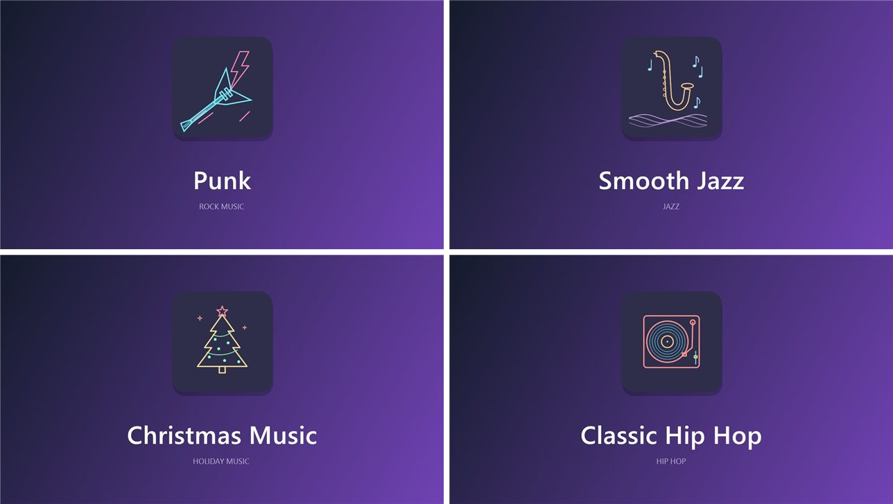 |
| `FuturisticSpotlight` | Futuristic with illustrated performers and a punk mohawk for selected genres. |  |
| `ClassicSpotlight` | Classic with illustrated Punk and Grunge cards. | 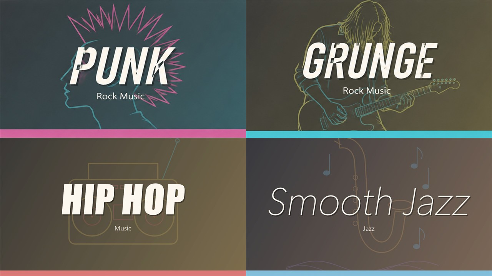 |
| `CartoonSpotlight` | Cartoon with illustrated performers and a punk mohawk for selected genres. | 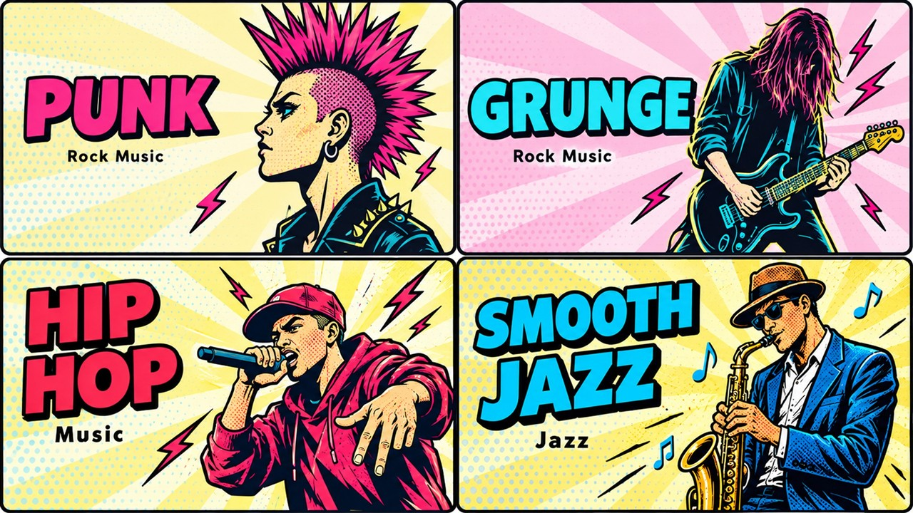 |
| `Neon` | Glowing neon line art on dark gradients (the original pack). |  |
| `Retro` | Cream paper, sunburst, stripes and offset print shadows in a muted 1970s palette. | 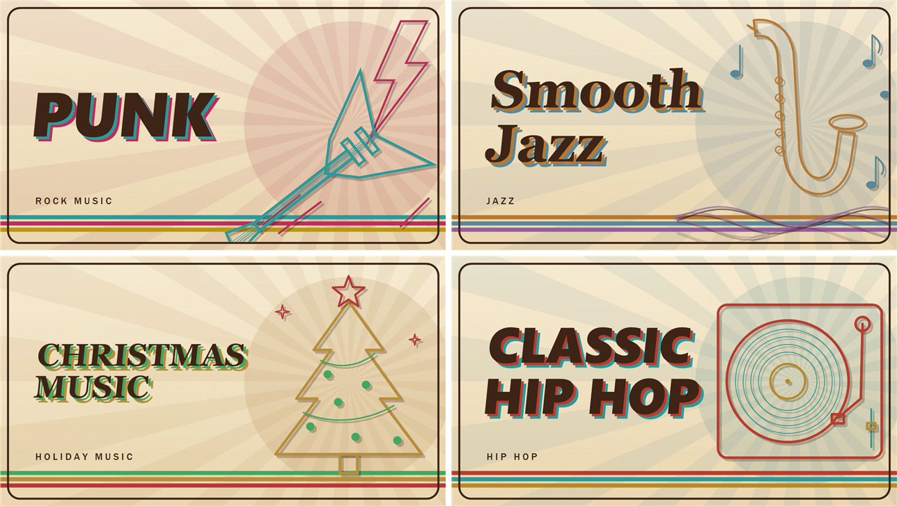 |
| `Cartoon` | Comic-panel border, burst rays and halftone dots with bold outlined line art. |  |
| `Cat` | Pastel paw-print wallpaper with a headphone-wearing cartoon cat; fur colour varies by genre. | 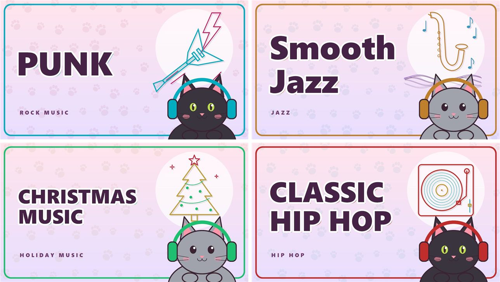 |
| `Dog` | Sunny bone-print wallpaper with a bandana-wearing cartoon dog; fur varies by genre. |  |
| `Nature` | Layered mountain ridges, pines, a soft sun and earthy line art. | 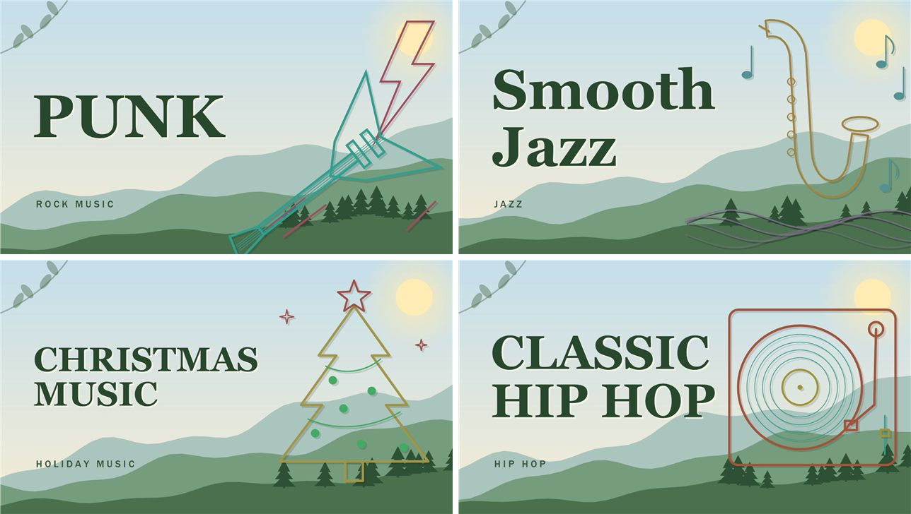 |
| `Blocky` | Chunky pixel art inspired by voxel sandbox games: blocky sky, clouds and grass-and-dirt ground. | 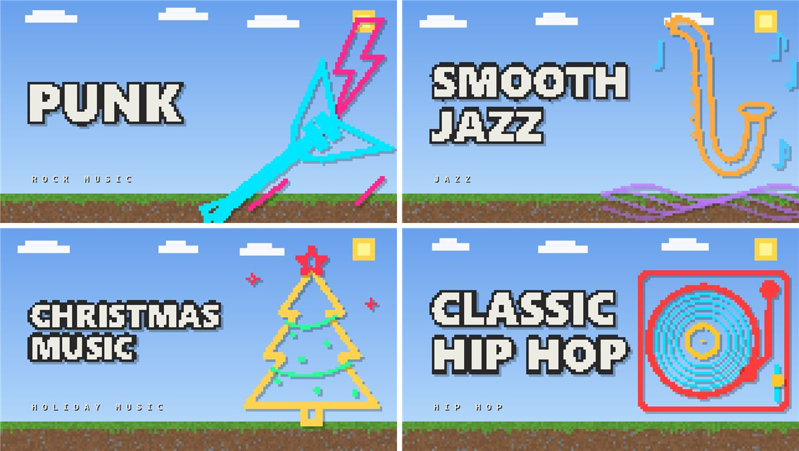 |
| `Rebel` | Scrappy sci-fi resistance: starfield, a dusky planet, weathered orange titles and hazard stripes. |  |
| `Imperial` | Cold, symmetrical sci-fi empire: steel panels, corridor lights and red accent bars. | 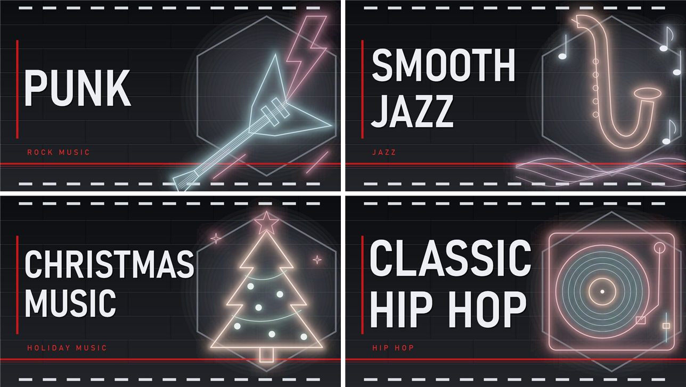 |
| `Elegant` | Quiet charcoal, a warm vignette, champagne hairline art and serif titles. | 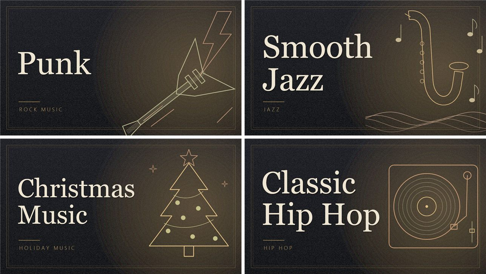 |

Themes are original designs. `Blocky`, `Rebel` and `Imperial` evoke familiar genres of game and film art without
using any franchise's names, logos, emblems or fonts.

The Spotlight themes retain their original base theme for genres without a Spotlight illustration. Futuristic Spotlight
and Cartoon Spotlight include illustrated Punk, Grunge, Hip Hop, Classic Rock, Smooth Jazz and Metal cards; Classic
Spotlight includes Punk and Grunge. These selected cards are supplied as fixed AI-generated illustrations in
`spotlight/`; other cards are rendered by the tool. The original themes and packs remain unchanged.
For language and location packs, Spotlight variants render the corresponding base theme. Root category Spotlight packs
add a staged light-cone and halo treatment to the matching base theme; the fixed genre illustrations are never used.

## Root category packs

[Download the root category packs](https://github.com/oconnoradv/EmbyTuneInArt/releases/tag/root-category-artwork-v1)
for any of the sixteen themes. Each ZIP contains eight 1280×720 cards for Local Radio, Music, By Language,
By Location, Talk, Sports, Podcasts and My Favorites. Spotlight variants use a distinct stage-light treatment over the
corresponding base theme.
These legacy packs require an older compatible TuneIn build. To use the schema 2 uploader, build a new category
ZIP instead. Upload an individual theme ZIP in
**Settings → TuneIn → Advanced Settings → Custom Artwork Packs**, or install it manually as described below,
then refresh the affected categories.

These sample sheets show the eight cards in the same order listed above:

**Cartoon**

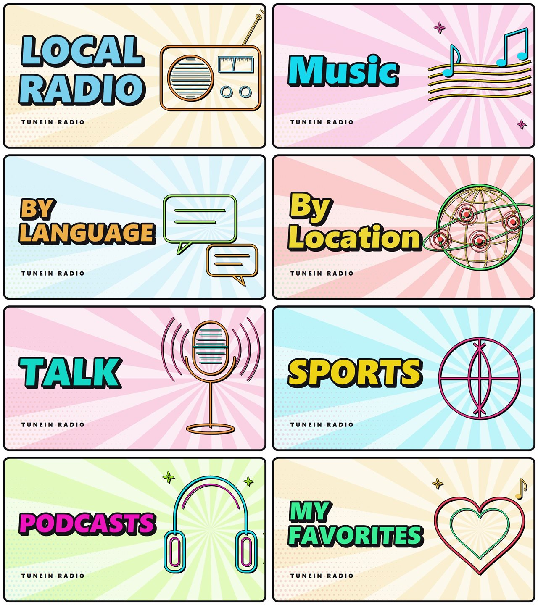

**Futuristic**

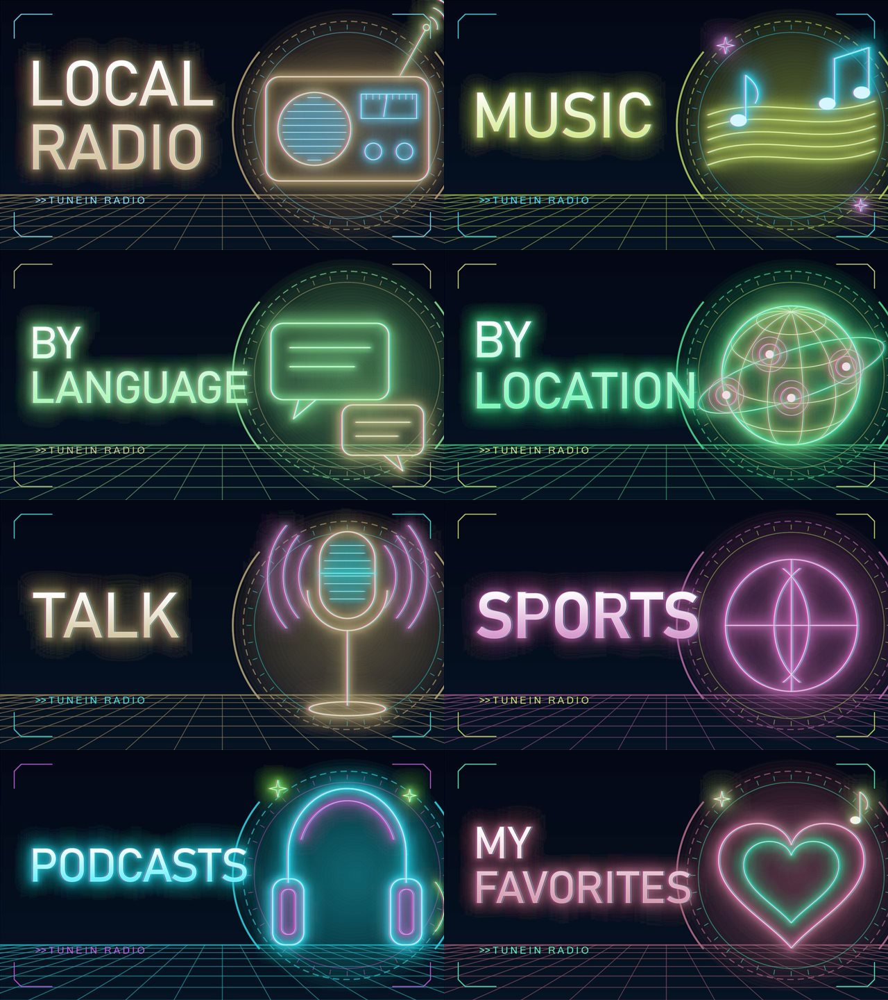

**Classic**

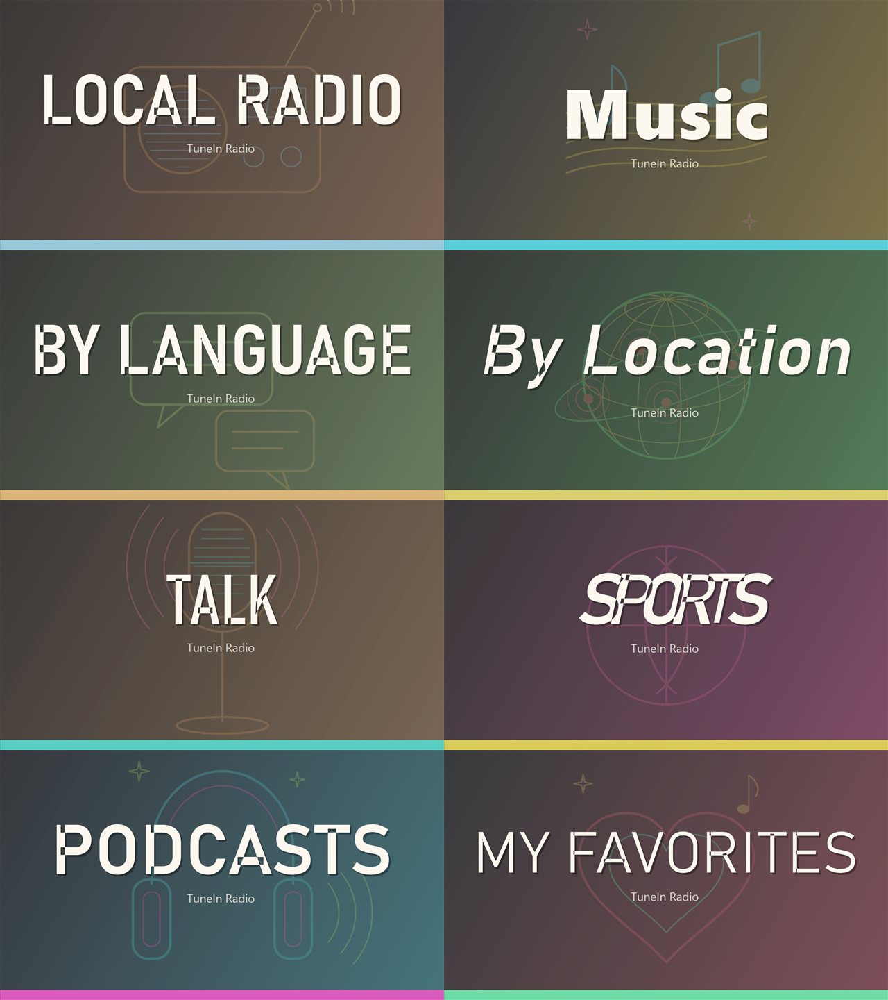

## Language and location pack samples

These are generated cards, reduced for display. Each row pairs a location with a language:
Japan (`r101255`) and Japanese (`l178`), Ireland (`r101252`) and Irish (`l176`), then Seattle-Tacoma
(`r100014`) and Korean (`l180`). The Seattle card uses a labeled Washington state outline and an approximate
Seattle marker, not metro boundaries. Language flags are representative rather than exclusive.
Scenic backgrounds and map-fill textures are decorative illustrations, not geographic or terrain data.

**Cartoon**

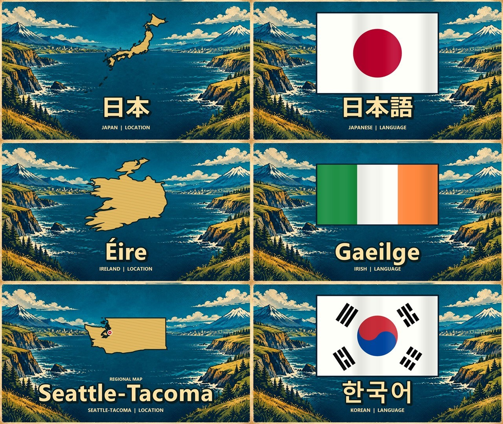

**Futuristic**

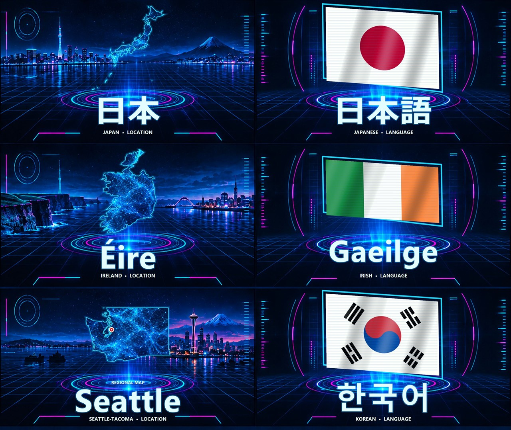

**Classic**

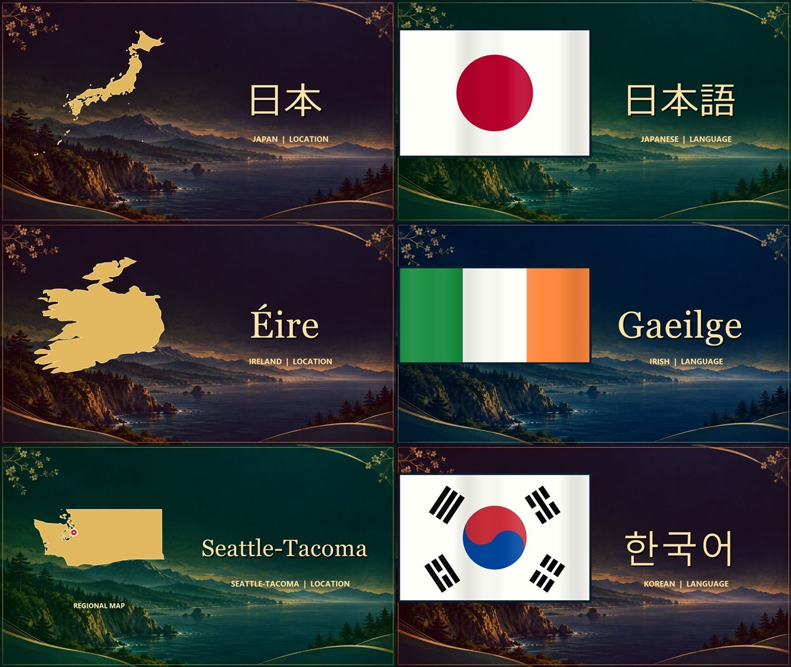

When no verified location or ancestor map is available, these three scoped styles use a labeled generic location
pin. Languages without a representative flag use a neutral speech motif, not an invented nationality.

### Subject-specific scenery and rebuilds

Scoped cards are built by `Build-GenreArtwork.ps1`: it composites illustrated scenery with verified map geometry,
representative flags, fitted native titles and captions. The tool does not create new scenic illustrations itself.
`data/scoped-scenes/subjects.json` identifies each illustrated subject by its guide ID and exact provider name;
add its background-only PNG to each `Cartoon`, `Futuristic` and `Classic` subfolder. A country entry may also supply
contextual scenery to its descendants; this does not imply city-specific scenery or change the map's coverage label.
Language scenery is selected separately, so a Classic language card can retain its restrained fabric background.

The Netherlands (`r100385`) and Dutch (`l101`) have dedicated canal, windmill and tulip scenery in all three
styles. Other catalog entries use the explicit country, language and verified state/province mappings in
`data/scoped-scenes/profiles.json`: 31 shared regional scenery profiles in each style. Dedicated subject artwork
takes precedence. Cities inherit their verified regional or country scenery while retaining individual names and
map coverage labels. Classic language cards use quiet fabric compositions. The shared North American city illustration contains
Seattle-like landmarks, so locations still assigned to that profile use a generic landscape instead.
Unmapped locations also use generic landscapes; generic scenery does not satisfy strict coverage.

Use the strict coverage option for refreshed builds:

```powershell
powershell -NoProfile -ExecutionPolicy Bypass -File Build-GenreArtwork.ps1 -Scope languages -Theme Cartoon -RequireScopedScenery -Pack
powershell -NoProfile -ExecutionPolicy Bypass -File Build-GenreArtwork.ps1 -Scope locations -Theme Classic -AllLocations -MaxLocationRequests 10000 -RequireScopedScenery -Pack
```

`-RequireScopedScenery` checks every selected subject **before writing images, manifests or ZIPs** and stops with
the missing count and example IDs if any card lacks declared subject/regional scenery or its required flag asset. It supports these three scoped base themes
and their Spotlight aliases only. With `-Only`, it checks the selected preview cards, not the complete catalog.
Without this option, generic fallbacks remain available. Coverage checks establish asset availability,
not visual quality; review the generated cards before publishing a release.
This changes strict-build results for locations previously using the Seattle-like North American shared profile:
generic replacements are rejected, whereas the old profile passed. Seven new regional scene sets cover the
remaining 327 generic-fallback locations in the complete 2026-11-24 snapshot of 2,032 locations. They are
illustrative shared landscapes, not depictions of each city; future catalogs may still need additional scenery.
Supply suitable subject/regional scenery or omit `-RequireScopedScenery` to allow generic landscapes.

## Complete language and location packs

The published [language and location packs](https://github.com/oconnoradv/EmbyTuneInArt/releases/tag/scoped-language-location-v2)
are legacy schema 1 packs. The language packs use a TuneIn catalog snapshot completed **2026-11-23 01:54:32 UTC**
and contain 91 cards per theme. Build new schema 2 packs for a schema 2-only uploader. Generated schema 2
manifests record the card count and per-image SHA-256 hashes; all cards are 1280×720.

| Theme | Languages | Locations |
|---|---|---|
| Cartoon | [Download](https://github.com/oconnoradv/EmbyTuneInArt/releases/download/scoped-language-location-v2/artpack-cartoon-languages.zip) | [Download](https://github.com/oconnoradv/EmbyTuneInArt/releases/download/scoped-language-location-v2/artpack-cartoon-locations.zip) |
| Futuristic | [Download](https://github.com/oconnoradv/EmbyTuneInArt/releases/download/scoped-language-location-v2/artpack-futuristic-languages.zip) | [Download](https://github.com/oconnoradv/EmbyTuneInArt/releases/download/scoped-language-location-v2/artpack-futuristic-locations.zip) |
| Classic | [Download](https://github.com/oconnoradv/EmbyTuneInArt/releases/download/scoped-language-location-v2/artpack-classic-languages.zip) | [Download](https://github.com/oconnoradv/EmbyTuneInArt/releases/download/scoped-language-location-v2/artpack-classic-locations.zip) |

Complete coverage means one image for each discovered ID, not a detailed local map or a flag for every card.
The language packs contain 78 representative flags and 13 neutral speech motifs; uncurated language names retain
their TuneIn labels. Shared regional scenery is illustrative, not a claim that every city has the pictured landmarks.
Scenic art and map textures are decorative, not terrain data. Verified geometry is never replaced by an AI-drawn map.
The [historical v1](https://github.com/oconnoradv/EmbyTuneInArt/releases/tag/scoped-language-location-v1)
and [v2 location packs](https://github.com/oconnoradv/EmbyTuneInArt/releases/tag/scoped-language-location-v2)
remain available unchanged.

## Install a ready-made pack

1. Build a schema 2 pack using the instructions below. Published legacy ZIPs are not accepted by the schema 2
   uploader; a new release is not yet available.
2. In Emby, open **Settings → TuneIn → Advanced Settings → Custom Artwork Packs**, then expand
   **Details & installation** for the folder paths. For example, the genres folder may be
   `C:\ProgramData\Emby-Server\programdata\plugins\configurations\TuneInArtwork\genres`.
3. Create the appropriate `genres`, `languages`, `locations` or `categories` folder if it does not exist and extract that scope's
   `.jpg` files and `tunein-artwork.json` into it. Keep one pack per scope. Do not mix manifests between folders.
4. Reload the TuneIn settings page. The artwork table shows the installed pack and image counts separately for
   **Music genres**, **Languages**, **Locations** and **Categories**. Details include modified and added counts.
5. Under **Catalog Refresh → TuneIn Library Refresh**, refresh **Music** for genres, **By Language** for
   languages or **By Location** for locations. Also refresh **By Language** after changing genre cards if you
   browse genres under languages. For root category artwork, refresh the corresponding categories. Alternatively use
   **Refresh all enabled categories**.

To go back to the default icons, remove that scope's images and refresh the corresponding catalog again.
Remove `tunein-artwork.json` too if the status should show Default artwork instead of the old pack name.
Only files named
after a TuneIn guide ID are used: `c` or `g` for genres, `l` for languages and `r` for locations, followed by
1–10 digits with a nonzero first digit. Root category filenames use the IDs listed below instead. Entries without an
image keep their default icons.

## Build your own pack, step by step

Requirements:

- Windows 11 with Windows PowerShell 5.1 (`System.Drawing`).
- The Windows fonts Bahnschrift, Segoe UI Variable, Segoe UI Black, Cascadia Mono, Impact, Georgia and
  Franklin Gothic Medium. A missing required title font stops the build.
- Internet access to `opml.radiotime.com` for genre, language and location catalogs; category builds are offline.
- For native scripts, Windows fonts including Meiryo, Microsoft YaHei, Malgun Gothic, Nirmala UI,
  Leelawadee UI, Myanmar Text and MV Boli. The build fails if a selected font is unavailable.
  Noto Sans Khmer and Noto Serif KR are bundled; Classic Japanese uses Windows MS Mincho.

1. **Clone the repository.**

   ```powershell
   git clone https://github.com/oconnoradv/EmbyTuneInArt.git
   cd EmbyTuneInArt
   ```

2. **Preview a few genres.** `-Only` takes guide IDs or `-like` name patterns. For languages it accepts the
   TuneIn label or the native title. Open the folder to check the cards.

   ```powershell
   powershell -NoProfile -ExecutionPolicy Bypass -Command "& .\Build-GenreArtwork.ps1 -Theme Retro -Output .\preview -Only 'Punk','Christmas*','Smooth Jazz'"
   ```

   Use `-Command` as shown: `-File` passes a comma-separated `-Only` list as one string.

3. **Adjust the look (optional).** Try other `-Theme` values or edit the tables described under
   [Customizing](#customizing), then repeat step 2 until you are happy.

4. **Build the full genre pack.** This writes the discovered cards and `tunein-artwork.json` to `.\output\genres`
   and the ZIP to `.\output\artpack-retro-genres.zip`. Default ZIP names follow `artpack-<theme>-<scope>`
   for all scopes, so genre ZIPs are distinct from `-categories` root-category ZIPs. Existing published genre ZIPs
   retain their historical `artpack-<theme>-v1.zip` names and use unsupported schema 1. `-PackName` overrides both
   the ZIP name and manifest identity; the default genre manifest identity remains `artpack-<theme>`.
   `-PackVersion` sets the manifest version for all four scopes and defaults to `1`. The number of cards depends on
   TuneIn's current catalog.

   ```powershell
   powershell -NoProfile -ExecutionPolicy Bypass -File Build-GenreArtwork.ps1 -Theme Retro -Pack
   ```

5. **Install it** by following [Install a ready-made pack](#install-a-ready-made-pack) from step 2, using your ZIP.
   To install straight from a build on the Emby server, point `-Output` at the artwork folder:

   ```powershell
   powershell -NoProfile -ExecutionPolicy Bypass -File Build-GenreArtwork.ps1 -Output 'C:\ProgramData\Emby-Server\programdata\plugins\configurations\TuneInArtwork\genres'
   ```

   Build other scopes with the same themes:

   ```powershell
   powershell -NoProfile -ExecutionPolicy Bypass -File Build-GenreArtwork.ps1 -Scope languages -Theme Cartoon -Pack
   powershell -NoProfile -ExecutionPolicy Bypass -File Build-GenreArtwork.ps1 -Scope locations -Theme Classic -Pack
   powershell -NoProfile -ExecutionPolicy Bypass -File Build-GenreArtwork.ps1 -Scope categories -Theme Futuristic -Pack
   ```

   Outputs default to `output\languages`, `output\locations` and `output\categories`, with scope-specific ZIP names. Scoped packs
   require a TuneIn build with schema 2 artwork-pack support.
   Root category packs require a build with category-pack support. Their static catalog contains `local` (Local Radio),
   `music` (Music), `language` (By Language), `location` (By Location), `talk` (Talk), `sports` (Sports),
   `podcast` (Podcasts) and `presets` (My Favorites). `channel` is not a category-pack entry. Use `-Only`
   to select category IDs or label patterns.
   To preview a bounded Canadian subtree through its cities:

   ```powershell
   powershell -NoProfile -ExecutionPolicy Bypass -Command "& .\Build-GenreArtwork.ps1 -Scope locations -LocationRoot r101227 -LocationRootLevel 2 -LocationDepth 4 -Only 'Canada','Alberta','Calgary' -Output .\preview-locations"
   ```

   The default root is `r0` (level 0). Levels 1–4 correspond to continent, country, region and city where
   TuneIn uses that hierarchy. Provider hierarchies vary; an explicitly supplied root must have its correct level.
   The default depth is 4 and discovery stops before browsing city nodes. At most 1,000 browse requests are made;
   exceeding `-MaxLocationRequests` fails the build rather than silently publishing an incomplete pack. A full
   locations build may hit that limit; increase it explicitly (maximum 10,000) or restrict the root/depth.
   Only location links are followed; station and other pivot items are ignored.
   `-AllLocations` instead browses every reachable canonical location link, including nested and deeper folders,
   with 250 ms between requests; the same request limit still applies. Station-only pagination is ignored;
   unsupported location pagination fails rather than silently truncating discovery. `-CatalogSnapshot <directory>` replays
   saved OPML responses named `languages.xml` and `r<ID>.xml` instead of requesting the network. Missing
   responses or unsuccessful provider statuses fail the build.

   Language titles use a curated mapping to Windows neutral-culture native names. Unknown or ambiguous categories
   retain the TuneIn label with a warning. Cartoon, Futuristic and Classic use explicitly curated representative
   flags with native proportions, including transparent nonrectangular flags. Umbrella or ambiguous categories
   retain neutral speech motifs. `-NeutralLanguages` disables representative flags. Other themes retain their
   existing flag/globe behavior. Flag provenance is recorded in `data/flags/` and included in every language ZIP,
   including non-scenic and neutral-language packs.

   Country outlines and curated US/Canadian region outlines use the bundled public-domain Natural Earth
   50m countries and 50m admin-1 data, matched by name and country, with 110m fallback data retained. France and
   the Netherlands use European outlines; their supported overseas locations have separate geometry. Region IDs are explicitly verified because
   the provider does not label regions versus cities. Map coverage is limited; cities can use the nearest verified
   ancestor outline labeled `Regional map`; unmatched
   regions and unsupported geometry use a pin explicitly labeled **Generic location** in these three scoped styles.
   Antimeridian-spanning shapes use a continuous longitude interval rather than a generic fallback.
   Longitude is scaled at the map's midpoint latitude to preserve local proportions.
   The map-fill textures are decorative, not terrain. A map is a stylized outline, not a navigation map. Seattle-Tacoma
   and Calgary use curated approximate city points. Other city points come from the public-domain Natural Earth 10m
   populated-places dataset (`data/NATURAL-EARTH-PLACES.txt`). Automatic matching requires an exact name and country,
   an unambiguous place, a directly associated verified country or US/Canadian region map, matching admin-1 for region
   maps, and a point inside the map geometry. Country-level names matching an admin-1 name are excluded to avoid
   mistaking a region for a city. TuneIn does not provide authoritative coordinates or a city/region classification,
   so automatic matches remain approximate and cannot establish every node's identity. Dots show city points, not metro or regional boundaries. Ambiguous names,
   composite areas, missing points, unsupported ancestry and locations outside the map remain unmarked; map centers are
   never substituted as coordinates.

6. **Share it (optional).** Publish the ZIP as a release, for example with
   `gh release create artpack-<name>-v1 .\output\<name>.zip`.

Each card prints `id  name  [style/motif]` as it is drawn.
Run the offline discovery and geometry checks with
`powershell -NoProfile -ExecutionPolicy Bypass -File .\tests\Scoped-Artwork.Tests.ps1`.
Run the offline category pack and theme checks with
`powershell -NoProfile -ExecutionPolicy Bypass -File .\tests\Category-Artwork.Tests.ps1 -Output .\output\category-check`.
Run the offline generated pack contract and scope/theme matrix with
`powershell -NoProfile -ExecutionPolicy Bypass -File .\tests\Artwork-PackContract.Tests.ps1 -Output .\output\contract-check`.
To check Spotlight and scoped rendering against the live TuneIn catalog, run
`powershell -NoProfile -ExecutionPolicy Bypass -File .\tests\Spotlight.Integration.Tests.ps1 -Output .\output\integration-check`.

## Pack manifest

Every build writes `tunein-artwork.json` next to the cards, and `-Pack` includes it in the ZIP. Schema 2 uses the
same required fields for all four scopes; unknown or duplicate fields, nulls and older schema uploads are rejected.

| Field | Meaning |
|---|---|
| `schemaVersion` | Integer `2`, independent of the pack or plugin version. |
| `scope` | Exact lowercase string `genres`, `languages`, `locations` or `categories`. |
| `packId`, `packName`, `theme`, `version` | Required strings identifying the pack, its display name, theme and content version. The plugin does not order versions. |
| `imageCount`, `images` | Required integer count and array; each entry has exactly `id`, `file` and SHA-256 `sha256` strings. |

`packId` matches `[A-Za-z0-9][A-Za-z0-9._-]{0,127}` and preserves case; `version` matches
`[0-9A-Za-z][0-9A-Za-z.+_-]{0,63}`. `packName` and `theme` must be trimmed, nonblank, at most 128 UTF-16
characters, and contain no control characters, colon, slash, backslash, `@`, or `www.` (case-insensitive).
The generator checks custom `-PackName` and `-PackVersion` before rendering and rejects Windows-reserved ZIP
names when `-Pack` is used. Flags are representative, not
exclusive; flag and scenery details are not manifest properties.

IDs are case-sensitive: genre IDs match `[cg][1-9][0-9]{0,9}`, language IDs `l[1-9][0-9]{0,9}`, and location IDs
`r[1-9][0-9]{0,9}`; category IDs are the eight names listed above. The filename must be the ID followed by
`.jpg` or `.png`; this generator writes JPEGs. IDs and filenames must be unique ignoring case, and each hash
must be 64 hexadecimal digits matching the image bytes. Partial packs are valid: `imageCount` must equal the
number of entries, from 1 to 20,000.

ZIP entries are flat at the root and consist only of the manifest, its declared images, and optional
`LICENSE.txt`, `Noto-OFL.txt`, `README.txt`, `FLAGS-SOURCES.txt`, and `flag-sources.json`. Supplements are
strict UTF-8, nonempty, at most 1 MiB each, and may contain no control characters except tab, CR and LF.
The uploader permits these five notices optionally; when either flag provenance file is present both are required.
The generator includes `LICENSE.txt`, `Noto-OFL.txt` and `README.txt` for every scope and includes both flag
provenance files for every language pack, including neutral and non-scenic themes. Other scopes omit the flag pair.
Duplicate, unknown, or nested files are invalid. The manifest is limited to 4 MiB, the ZIP to
768 MiB, total expanded content to 2 GiB, and each image to 16 MiB, 4096 pixels per side and 16,777,216 pixels.
The uploader additionally checks ZIP structure, scans entries and decodes each image. The generator checks its
serialized manifest, JPEG headers, image decoding, hashes, sizes and generated ZIP contents before replacing
the destination ZIP; the plugin remains the final authority on upload. A failed build can leave rendered files
in the output directory, but validation failure does not replace an existing ZIP.

Default `-Scope` is `genres`, default `-Theme` is `Futuristic`, and default `-PackVersion` is `1`.
Default IDs are `artpack-<theme>` for genres and `artpack-<theme>-<scope>` for other scopes.
The default ZIP name is `artpack-<theme>-<scope>.zip`; `-PackName` overrides the ZIP name and manifest `packId`
for every scope. `packName` and `theme` are the selected theme. Spotlight genre entries use bundled cards
where available; other genres use the base theme. Scoped Spotlight cards use their base scoped theme.

Builds are not byte-reproducible: ZIP timestamps, live catalog responses, Windows fonts and rendering/encoder
versions can vary. `-CatalogSnapshot` freezes language and location responses, not genre discovery; it does not
freeze the other inputs. Schema 2 does not record a build timestamp or tool commit. Hashes describe the actual
bytes of each build.

The plugin compares installed files with the manifest: missing entries are absent, matching hashes identify
unchanged pack cards, differing hashes identify modified cards, and extra files are added images. The manifest
and ZIP list only cards rendered in the current build, so a `-Only` build describes just those cards. Use a clean
output folder when switching packs: older files are not deleted and the plugin can report them as added images.

## Roadmap

- **GUI front end.** A future version will add a graphical front end to simplify usage: pick entries, preview cards,
  tune styles and glow, and build or install a pack without editing the script or using the command line.

## How it works

1. **Discovery.** Genres come from `Browse.ashx?c=music` and each top-level genre's `Browse.ashx?id=<id>`.
   Languages come from `Browse.ashx?c=lang`, using each link's `filter=l…` rather than its hub ID.
   Locations use the bounded `Browse.ashx?id=r…` hierarchy. Root categories use a static catalog without discovery.
   Each output file is named `<id>.jpg`.
2. **Style.** `$Parents` maps every top-level genre to a style group and default motif. Subgenres inherit
   their parent's style.
3. **Typography and palette.** `$Styles` defines each style group's font, case, shear, title mode
   (`Fill` or `Tube` outline), maximum size and palette (`bgTop`, `bgBottom`, three neon colours).
   A subgenre uses the parent's colours, rotated by a per-genre seed, so siblings differ.
4. **Motif.** The `$Overrides` table maps subgenre name regexes to a motif and is checked in order; the
   first match wins. `$Places` gives a latitude and longitude, which mark World subgenres on the globe motif.
   For languages and locations, `Scoped-Artwork.ps1` chooses representative flags, verified map outlines or neutral
   globes. Root categories use their own style and motif assignments.
5. **Theme.** `$Themes` holds one entry per theme. An entry can recolour the palette (`Color`), set the line-art
   mode (`Art`: `Glow`, `Flat` with shadow and outline, or `Pixel`), and supply the `Background`, a `Clip`, a
   `Character`, the `Title` treatment, font overrides and the subtitle style.
6. **Rendering.** `New-Card` draws, in order:
   - the theme background;
   - the motif, through `Neon`, in the theme's line-art mode (scaled and moved by the theme's `OX`, `OY`, `Scale`);
   - the theme character, if any (the Cat and Dog themes);
   - the title, auto-fitted on 1–3 lines by `Title-Path` and drawn by the theme;
   - a parent-genre or scope-specific subtitle.

## Customizing

- **New motif:** add `function Motif-<name>($cl, $info)` that calls `Neon $cl[i] { param($g, $c, $k) ... }`.
  - Draw around (0,0), within about ±240 × ±290; `$script:OX`/`$script:OY` place the artwork.
  - Build pens with `Pn $c <width> $k` so every theme can scale the stroke.
  - Then reference the motif from `$Parents` or `$Overrides`.
- **New theme:** copy a `$Themes` entry, rename it and add the name to the `-Theme` `ValidateSet`.
- **Glow strength:** `$script:Weight` scales every stroke (default 0.7). A theme's `Art.Glow` sets the glow
  opacity (Neon uses 0.65). The `0.08, 0.04, 0.02` scales set the glow radius. Higher values look louder
  and blurrier.
- **Title look:** edit the matching `$Styles` entry. `Tube` titles are outlined; `Fill` titles are solid.
- **New TuneIn genres** are picked up automatically and use their parent's defaults. Add an override
  when a more specific motif fits.
- **Language and location artwork:** edit the curated culture, flag and verified-region mappings in
  `Scoped-Artwork.ps1`; unverified categories deliberately keep their provider name or generic motif.

## License

EmbyTuneInArt and the artwork it produces are licensed under the [GNU General Public License v3.0](LICENSE).
The bundled `data\natural-earth.json` is derived from Natural Earth v5.1.2
[`ne_110m_admin_0_countries`](https://github.com/nvkelso/natural-earth-vector/blob/v5.1.2/geojson/ne_110m_admin_0_countries.geojson)
and [`ne_50m_admin_1_states_provinces`](https://github.com/nvkelso/natural-earth-vector/blob/v5.1.2/geojson/ne_50m_admin_1_states_provinces.geojson):
only names, country names and geometry were retained. Natural Earth data is
[public domain](https://www.naturalearthdata.com/about/terms-of-use/). The flag motifs are original geometric drawings.
Japan and Ireland outlines additionally use Natural Earth
[`ne_50m_admin_0_countries`](https://github.com/nvkelso/natural-earth-vector/blob/v5.1.2/geojson/ne_50m_admin_0_countries.geojson).
The scoped scenic layers in `data\scoped-scenes` and `data\scenes` were AI-generated for this project and are
decorative, not geographic data. The seven North American regional sets added in 2026 were generated using
existing project scenery as style references. Specific scenes are used only for matching subjects; other cards
use shared regional or generic scenes. They and the produced artwork are distributed under GPL-3.0.
The Korean flag construction follows the
[Republic of Korea Ministry of the Interior and Safety](https://www.mois.go.kr/eng/sub/a03/nationalSymbol/screen.do).
The approximate [Seattle coordinates](https://www.geodatos.net/en/coordinates/united-states/seattle) are used
only for the Seattle-Tacoma regional marker.
`data\NotoSansKhmer-Regular.ttf` is from
[Noto Fonts](https://github.com/notofonts/noto-fonts/tree/ffebf8c1ee449e544955a7e813c54f9b73848eac/hinted/ttf/NotoSansKhmer)
and is distributed under the [SIL Open Font License 1.1](data/Noto-OFL.txt).
`data\NotoSerifKR-Regular.otf` is from
[Noto CJK](https://github.com/notofonts/noto-cjk/blob/f8d157532fbfaeda587e826d4cd5b21a49186f7c/Serif/SubsetOTF/KR/NotoSerifKR-Regular.otf)
and is also distributed under the [SIL Open Font License 1.1](data/Noto-OFL.txt).
