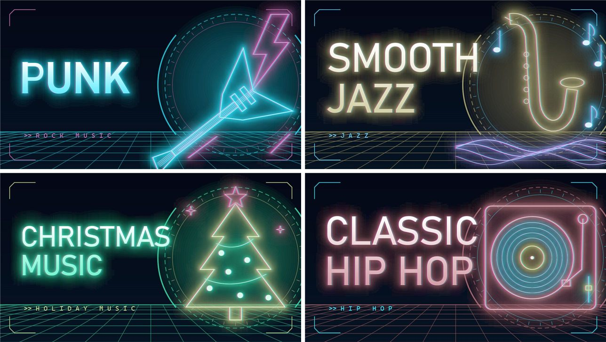
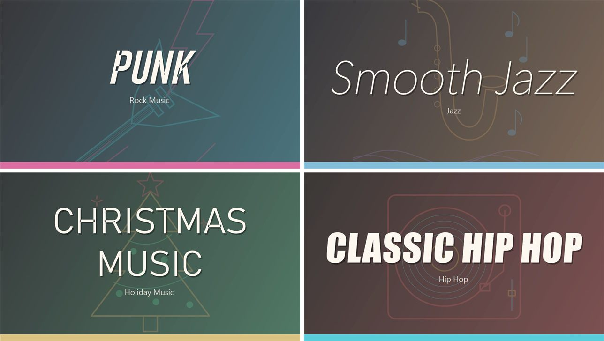
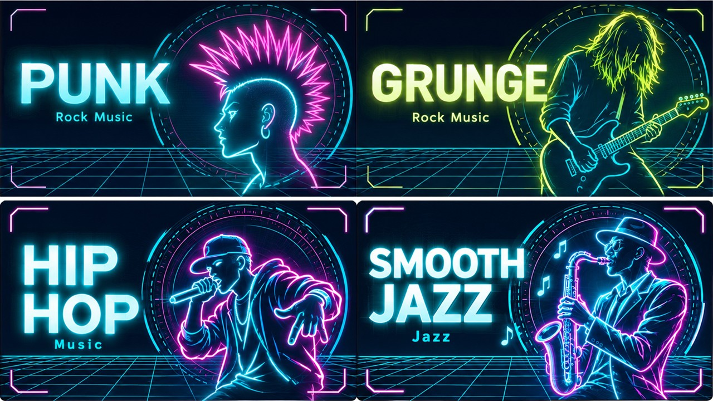
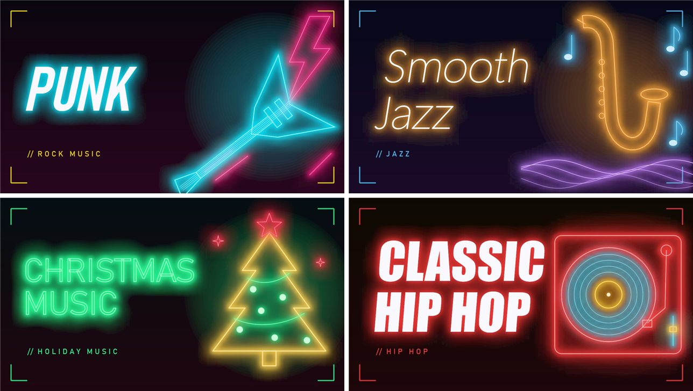
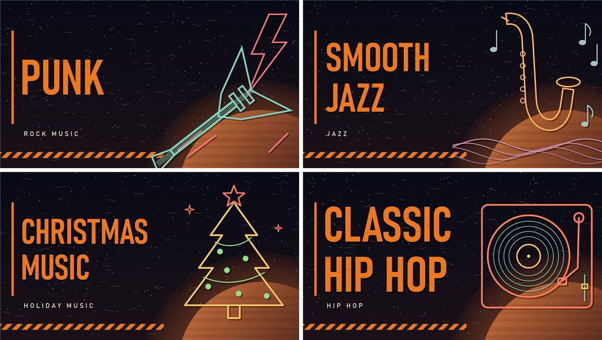

# EmbyTuneInArt — genre art-packs for the EmbyTuneIn plugin


EmbyTuneInArt builds optional artwork packs for the music genre folders of the
[Emby TuneIn plugin](https://github.com/oconnoradv/EmbyTuneIn). `Build-GenreArtwork.ps1` renders one original
1280×720 card per TuneIn music genre and subgenre in one of sixteen [themes](#themes). Each parent genre gets its own
typography, palette and line art. The cards contain no TuneIn logos or station images.

The plugin ships with its default category icons. Packs are optional: install one and the Music genre folders in
Emby show its cards instead. Ready-made packs are on the [Releases](https://github.com/oconnoradv/EmbyTuneInArt/releases)
page; build your own to change the look.

## Themes

Pick a theme with `-Theme <name>` (default `Futuristic`). Original theme samples show Punk, Smooth Jazz, Christmas Music
and Classic Hip Hop. Spotlight samples show Punk, Grunge, Hip Hop and Smooth Jazz.

| Theme | Look | Sample |
|---|---|---|
| `Futuristic` | Holographic HUD rings, a perspective grid floor, scanlines and chromatic glow. |  |
| `Classic` | Bold centred typography in each genre's font on a rich genre gradient, with faint line art and an accent band. |  |
| `Tile` | The original plugin look: a dark-to-violet gradient, line art in a rounded tile and a centred caption. |  |
| `FuturisticSpotlight` | Futuristic with illustrated performers and a punk mohawk for selected genres. |  |
| `ClassicSpotlight` | Classic with illustrated Punk and Grunge cards. |  |
| `CartoonSpotlight` | Cartoon with illustrated performers and a punk mohawk for selected genres. |  |
| `Neon` | Glowing neon line art on dark gradients (the original pack). |  |
| `Retro` | Cream paper, sunburst, stripes and offset print shadows in a muted 1970s palette. |  |
| `Cartoon` | Comic-panel border, burst rays and halftone dots with bold outlined line art. |  |
| `Cat` | Pastel paw-print wallpaper with a headphone-wearing cartoon cat; fur colour varies by genre. |  |
| `Dog` | Sunny bone-print wallpaper with a bandana-wearing cartoon dog; fur varies by genre. |  |
| `Nature` | Layered mountain ridges, pines, a soft sun and earthy line art. |  |
| `Blocky` | Chunky pixel art inspired by voxel sandbox games: blocky sky, clouds and grass-and-dirt ground. |  |
| `Rebel` | Scrappy sci-fi resistance: starfield, a dusky planet, weathered orange titles and hazard stripes. |  |
| `Imperial` | Cold, symmetrical sci-fi empire: steel panels, corridor lights and red accent bars. |  |
| `Elegant` | Quiet charcoal, a warm vignette, champagne hairline art and serif titles. |  |

Themes are original designs. `Blocky`, `Rebel` and `Imperial` evoke familiar genres of game and film art without
using any franchise's names, logos, emblems or fonts.

The Spotlight themes retain their original base theme for genres without a Spotlight illustration. Futuristic Spotlight
and Cartoon Spotlight include illustrated Punk, Grunge, Hip Hop, Classic Rock, Smooth Jazz and Metal cards; Classic
Spotlight includes Punk and Grunge. These selected cards are supplied as fixed AI-generated illustrations in
`spotlight/`; other cards are rendered by the tool. The original themes and packs remain unchanged.

## Install a ready-made pack

1. Download a pack ZIP, for example `artpack-neon-v1.zip`, from
   [Releases](https://github.com/oconnoradv/EmbyTuneInArt/releases).
2. In Emby, open **Settings → TuneIn**. Under the animated TuneIn header, the page shows the artwork folder,
   for example `C:\ProgramData\Emby-Server\programdata\plugins\configurations\TuneInArtwork\genres`.
3. Create that folder if it does not exist and extract the pack's `.jpg` files and `tunein-artwork.json` into it.
4. Reload the TuneIn settings page. It should report the number of installed genre images.
5. Open **Catalog Refresh** and refresh **Music**. Genre folders now show the pack's cards.

To go back to the default icons, delete the images and refresh Music again. Only files named after a TuneIn guide
ID (`c57943.jpg`, `g79.png`) are used; genres without an image keep the Music icon.

## Build your own pack, step by step

Requirements:

- Windows 11 with Windows PowerShell 5.1 (`System.Drawing`).
- The Windows 11 fonts Bahnschrift, Segoe UI Variable, Segoe UI Black, Cascadia Mono, Impact, Georgia and
  Franklin Gothic Medium. Elsewhere GDI+ substitutes fonts and the cards look different.
- Internet access to `opml.radiotime.com`, which supplies the current genre list.

1. **Clone the repository.**

   ```powershell
   git clone https://github.com/oconnoradv/EmbyTuneInArt.git
   cd EmbyTuneInArt
   ```

2. **Preview a few genres.** `-Only` takes guide IDs or `-like` name patterns. Open the folder to check the cards.

   ```powershell
   powershell -NoProfile -ExecutionPolicy Bypass -Command "& .\Build-GenreArtwork.ps1 -Theme Retro -Output .\preview -Only 'Punk','Christmas*','Smooth Jazz'"
   ```

   Use `-Command` as shown: `-File` passes a comma-separated `-Only` list as one string.

3. **Adjust the look (optional).** Try other `-Theme` values or edit the tables described under
   [Customizing](#customizing), then repeat step 2 until you are happy.

4. **Build the full pack.** This writes every card and `tunein-artwork.json` to `.\output\genres` and the ZIP to `.\output\artpack-retro.zip`
   (`-PackName` overrides the name; it defaults to `artpack-<theme>`. `-PackVersion` sets the manifest version; it defaults to `1`). A full run writes about 123 cards.

   ```powershell
   powershell -NoProfile -ExecutionPolicy Bypass -File Build-GenreArtwork.ps1 -Theme Retro -Pack
   ```

5. **Install it** by following [Install a ready-made pack](#install-a-ready-made-pack) from step 2, using your ZIP.
   To install straight from a build on the Emby server, point `-Output` at the artwork folder:

   ```powershell
   powershell -NoProfile -ExecutionPolicy Bypass -File Build-GenreArtwork.ps1 -Output 'C:\ProgramData\Emby-Server\programdata\plugins\configurations\TuneInArtwork\genres'
   ```

6. **Share it (optional).** Publish the ZIP as a release, for example with
   `gh release create artpack-<name>-v1 .\output\<name>.zip`.

Each card prints `id  name  [style/motif]` as it is drawn.

## Pack manifest

Every build writes `tunein-artwork.json` next to the cards, and `-Pack` includes it in the ZIP. It is installed
in the `genres` folder with the images so the TuneIn plugin can identify the pack:

| Field | Meaning |
|---|---|
| `schemaVersion` | Manifest format version, currently `1`. |
| `packId`, `packName`, `theme`, `version` | Pack identity, for example `artpack-cartoon`, `Cartoon`, `Cartoon`, `1`. |
| `description` | The theme's one-line description. |
| `minPluginVersion` | Oldest TuneIn plugin version the pack supports (`1.2.8.0`). |
| `sampleImageUrl`, `sourceUrl` | A sample image and the repository the pack was built from. |
| `toolCommit`, `builtUtc`, `license` | The tool commit, build time and licence (`GPL-3.0`). |
| `imageCount`, `images` | One entry per card: `id`, `name`, `parent`, `file`, `bytes` and lower-case `sha256`. |

The plugin can count installed images and compare each file's SHA-256 with the manifest. A missing or
different hash means the user added or replaced that image. The manifest lists only cards present in the output
folder, so a `-Only` build describes just those cards.

## Roadmap

- **GUI front end.** A future version will add a graphical front end to simplify usage: pick genres, preview cards,
  tune styles and glow, and build or install a pack without editing the script or using the command line.
## How it works

1. **Genre list.** The tool reads `Browse.ashx?c=music` for top-level genres (IDs `c…`/`g…`) and
   `Browse.ashx?id=<id>` for each genre's subgenres (`g…`). Each output file is named `<guide_id>.jpg`.
2. **Style.** `$Parents` maps every top-level genre to a style group and default motif. Subgenres inherit
   their parent's style.
3. **Typography and palette.** `$Styles` defines each style group's font, case, shear, title mode
   (`Fill` or `Tube` outline), maximum size and palette (`bgTop`, `bgBottom`, three neon colours).
   A subgenre uses the parent's colours, rotated by a per-genre seed, so siblings differ.
4. **Motif.** The `$Overrides` table maps subgenre name regexes to a motif and is checked in order; the
   first match wins. `$Places` gives a latitude and longitude, which mark World subgenres on the globe motif.
5. **Theme.** `$Themes` holds one entry per theme. An entry can recolour the palette (`Color`), set the line-art
   mode (`Art`: `Glow`, `Flat` with shadow and outline, or `Pixel`), and supply the `Background`, a `Clip`, a
   `Character`, the `Title` treatment, font overrides and the subtitle style.
6. **Rendering.** `New-Card` draws, in order:
   - the theme background;
   - the motif, through `Neon`, in the theme's line-art mode (scaled and moved by the theme's `OX`, `OY`, `Scale`);
   - the theme character, if any (the Cat and Dog themes);
   - the title, auto-fitted on 1–3 lines by `Title-Path` and drawn by the theme;
   - the parent-genre subtitle.

## Customizing

- **New motif:** add `function Motif-<name>($cl, $info)` that calls `Neon $cl[i] { param($g, $c, $k) ... }`.
  - Draw around (0,0), within about ±240 × ±290; `$script:OX`/`$script:OY` place the artwork.
  - Build pens with `Pn $c <width> $k` so every theme can scale the stroke.
  - Then reference the motif from `$Parents` or `$Overrides`.
- **New theme:** copy a `$Themes` entry, rename it and add the name to the `-Theme` `ValidateSet`.
- **Glow strength:** `$script:Weight` scales every stroke (default 0.7). A theme's `Art.Glow` sets the glow
  opacity (Neon uses 0.65). The `0.08, 0.04, 0.02` scales set the glow radius. Higher values look louder
  and blurrier.
- **Title look:** edit the matching `$Styles` entry. `Tube` titles are outlined; `Fill` titles are solid.
- **New TuneIn genres** are picked up automatically and use their parent's defaults. Add an override
  when a more specific motif fits.

After you replace installed images, refresh Music again. The plugin notices the changed files and replaces
Emby's cached folder images.

## License

EmbyTuneInArt and the artwork it produces are licensed under the [GNU General Public License v3.0](LICENSE).
